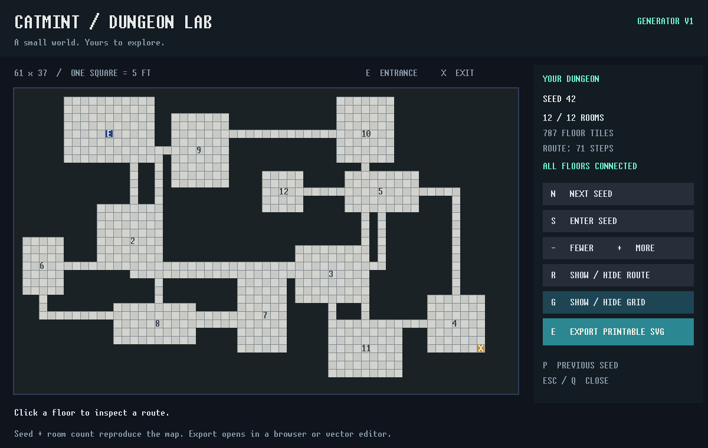

# Catmint Dungeon Lab

A native dungeon generator for a tabletop session: choose a seed, inspect the
layout, and export an editable, printable SVG. Written entirely in Catmint,
using its existing SDL wrapper and bitmap font.



## Run a packaged build

Download the artifact for your OS and architecture from a successful
[CI run](https://github.com/drugescu/catmint/actions/workflows/ci.yml).
Extract it, open a terminal in the extracted folder, and run:

```sh
chmod +x dungeon-lab              # artifact ZIPs do not preserve executable mode
./dungeon-lab
./dungeon-lab --seed 2026 --rooms 16
./dungeon-lab --seed 2026 --rooms 16 --export my-dungeon.svg
```

Runtime dependency: SDL2 (`sudo apt install libsdl2-2.0-0` on Ubuntu 24.04;
`brew install sdl2` on macOS). LLVM, a C/C++ compiler, Python, SDL_ttf and
external font/image files are not needed to run the packaged executable.
Linux artifacts target the CI runner's glibc; they are not universal Linux
binaries. macOS artifacts target the CI runner's architecture and Homebrew SDL2.
The first version supports Linux and macOS, with a fixed 1200 x 760 window.

`example-42.svg` is ready to open in a browser or vector editor. Print-to-fit
makes an overview/handout; for physical 1-inch squares, print or tile at
61 x 37 inches (the map grid is 61 x 37 cells). One cell represents five feet.
No virtual tabletop integration is required: SVG is the interchange format.

## Controls

| Action | Key / mouse |
|---|---|
| Next / previous seed | N / P |
| Enter an exact seed | S, digits, Enter; Esc cancels |
| Fewer / more rooms | - / + (or =) |
| Inspect a shortest path from the entrance | Click a floor tile |
| Show / hide the selected route | R |
| Show / hide the screen grid | G |
| Export a printable SVG | E |
| Close | Q / Esc, or the window close button |

Buttons on the right perform the same actions. The export goes into the current
folder as `dungeon-SEED-ROOMS.svg`; exporting again replaces that same file.
The status line reports success or failure. `--export FILE` specifies a path
and exports without opening a window. The destination folder must exist.

The screen uses E for the entrance, X for an exit at maximum walking distance,
and numbers for rooms. Paths use four-direction movement, without diagonals.
The screen's route and grid switches do not affect the printable export.

## Reproducibility and limits

Generator **v1**, seed and requested room count identify a layout. Seeds are
decimal integers in 1..2147483647; room counts are 6..20. There are 400 placement
attempts, so a crowded map can contain fewer rooms than requested: both counts
are shown. Each accepted rectangular room is joined to its predecessor with an
L corridor. Rooms do not overlap; corridors can intersect rooms or each other.
The outer wall stays sealed and every floor tile is reachable.

This is a layout tool, not a full adventure generator: no encounters, doors,
furniture, fog of war or image assets. Use the room numbers for your own notes.
Changing the algorithm later requires a new generator version, keeping v1
available if existing seeds are to remain reproducible.

## Build from source

Follow the repository's [compiler setup](https://github.com/drugescu/catmint/blob/master/COMPILING.md), then:

```sh
./test.sh
./examples/dungeon-lab/build.sh
./examples/dungeon-lab/dungeon-lab
./examples/dungeon-lab/check.sh
```

Install SDL2 development headers/libraries to build (`libsdl2-dev` or Homebrew
`sdl2`). The app adds no language features or C glue. Build flags pass through:
`./examples/dungeon-lab/build.sh -O0` or `--asan`.

`package.sh OUTPUT_DIRECTORY` packages the built executable, this README,
license, sample export and corresponding source. Packages are CI artifacts;
this PR does not publish a release or install anything on a user's machine.

## Verification

`check.py` runs 108 seed/settings combinations and uses an independent Python
BFS to check connectivity, the farthest exit, shortest-path length and route
contents. It also checks deterministic regeneration, seed entry, buttons,
limits, invalid arguments/scripts, export failure, SVG geometry and BMP pixels.
The script calls the same key/text/click handlers as the window; it does not
simulate physical input through an OS window manager.

```sh
./dungeon-lab --dump --seed 42                   # versioned map + selected route
./dungeon-lab --shot screenshot.bmp              # render once and exit
./dungeon-lab --headless --play actions.play     # no window
```

Input scripts contain one action per line: `key 110`, `text 1234`, or
`click 950 320`; `#` starts a comment line. Key codes are SDL character codes
(110 is N, 115 is S, 13 is Enter, 27 is Esc). Input order is deterministic;
there are no frame timings. `--shot` requires rendering and cannot accompany
`--headless`, `--dump` or `--export`. Screenshots work under SDL's dummy video
driver when `SDL_RENDER_DRIVER=software` is set.

The normal repository `test.sh --thorough` includes the app's checks when SDL2
is installed. CI also runs its checker under ASan/LSan on Linux and ASan on
macOS. Model, controller and renderer are separate files, so bugs can be
isolated without a window.
